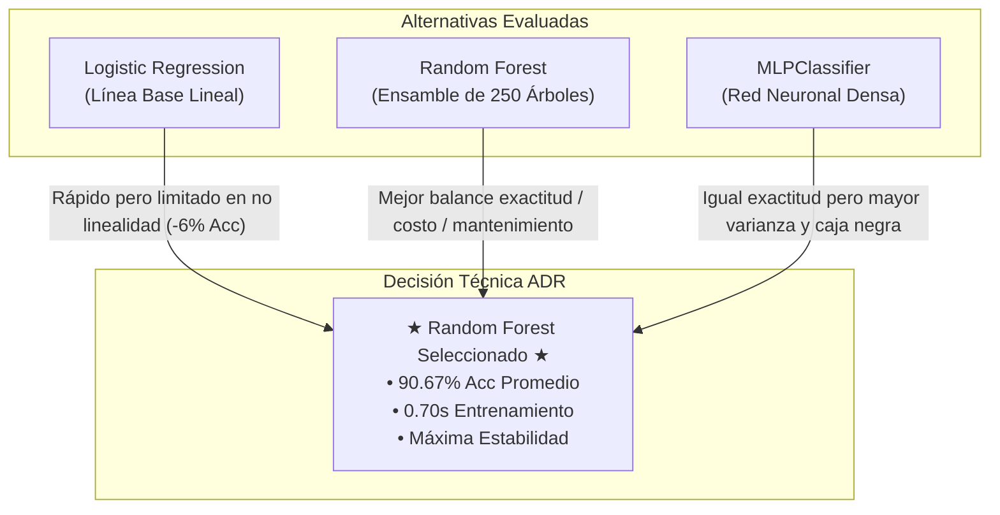
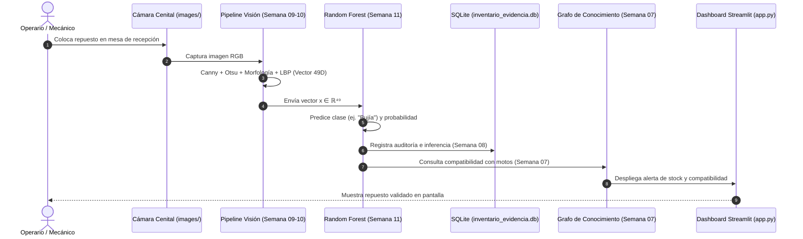

# ADR Semana 11 - Selección de Modelo y Decisión Técnica con Evidencia

* **Asignatura:** Inteligencia Artificial (10.º Semestre - Ingeniería de Sistemas)
* **Proyecto:** Sistema Inteligente de Monitoreo, Logística, Inventario y Visión para Taller de Motos
* **Estudiantes:** Erick Santiago Garcia Sanchez | Oscar David Gutierrez
* **Modalidad:** Individual
* **Fecha:** Octubre 2026
* **Estado del Registro:** APROBADO (Decisión Técnica Basada en Benchmark Empírico)

---

## 1. Contexto del Problema

### 1.1 Naturaleza del Dominio y Necesidad Operativa
En un taller mecánico y centro de repuestos de motocicletas, la recepción, auditoría y clasificación física de componentes en el área de bodega suele realizarse de forma manual. Esto introduce cuellos de botella en el despacho, errores de digitación en el ERP y falta de trazabilidad en piezas visualmente críticas (por ejemplo, confundir una bujía deteriorada con una apta para uso, o clasificar erróneamente componentes cilíndricos como pistones frente a amortiguadores).

Para automatizar este flujo, el proyecto integra una estación de inspección por visión computacional sobre la mesa de recepción del taller. La cámara cenital captura las piezas que ingresan y, a través del pipeline desarrollado en las semanas anteriores, las transforma en representaciones numéricas procesables:
* **Semana 09:** Segmentación de contornos mediante Canny Edge Detection y cálculo del umbral óptimo global de Otsu.
* **Semana 10:** Extracción morfológica en 8-conectividad con filtro de área ($A \ge 50$ px), histograma de reflectancia e intensidad (32 bins normalizados) y descriptores de micro-textura LBP circular uniforme ($P=8, R=1$, 10 bins). El resultado es un **vector compacto de 49 dimensiones ($\vec{v} \in \mathbb{R}^{49}$)** por imagen.

### 1.2 Objetivo de la Semana 11
El propósito no es seleccionar un algoritmo por intuición, popularidad o novedad técnica, sino **ejecutar un benchmark experimental bajo un estricto protocolo de ingeniería**, midiendo exactitud (*accuracy*), costo temporal de ajuste (*fit_seconds*) y estabilidad entre ejecuciones para justificar formalmente mediante un *Architecture Decision Record* (ADR) qué modelo de Machine Learning debe gobernar la clasificación en el sistema final.

### 1.3 Restricciones del Sistema
1. **Datos de Dominio Real:** Prohibido el uso de datasets genéricos ajenos (como dígitos MNIST o `load_digits`) o datos sintéticos hardcodeados sin sustento físico. Los datos provienen de los componentes reales fotografiados en el taller (`images/` y `data/imagen_proyecto.png`).
2. **Equidad Comparativa (Fair Split):** Los tres modelos evaluados deben someterse con rigor matemático al **mismo conjunto de datos** y a la **misma partición de entrenamiento y prueba**, evitando cualquier sesgo por distribución dispar.
3. **Restricción de Latencia en Inferencia y Entrenamiento:** La inferencia en la estación de trabajo debe ser sub-segundo, y el reentrenamiento ante nuevos lotes debe ser viable sin requerir infraestructura aceleradora GPU dedicada.
4. **Explicabilidad vs. Capacidad Predictiva:** El sistema interactúa con mecánicos y administradores de taller; un modelo incomprensible con ganancias marginales de precisión puede representar un riesgo operativo frente a una solución robusta y auditable.

---

## 2. Modelos Comparados

Se evaluaron tres paradigmas fundamentales del Machine Learning supervisado para clasificación multiclase (6 categorías de repuestos: `Bujia`, `Chasis`, `Llanta`, `Piston`, `Sillin`, `Suspension`):

| Modelo | Paradigma Técnico | Configuración e Hiperparámetros | Función en el Benchmark |
| :--- | :--- | :--- | :--- |
| **Logistic Regression** | Modelo lineal paramétrico generalizado con función Softmax multiclase. | `make_pipeline(StandardScaler(), LogisticRegression(max_iter=1500, random_state=42))` | **Línea Base (Baseline):** Referencia mínima obligatoria. Mide si la separación lineal en $\mathbb{R}^{49}$ es suficiente antes de justificar modelos complejos. |
| **Random Forest** | Ensamble no paramétrico de ensacado (*bagging*) de árboles de decisión no correlacionados. | `RandomForestClassifier(n_estimators=250, random_state=42, n_jobs=-1)` | **Ensamble No Lineal:** Evalúa la ganancia al capturar interacciones no lineales entre textura LBP y proporciones morfológicas sin requerir normalización previa. |
| **MLPClassifier** | Red Neuronal Artificial multicapa de propagación hacia adelante (*feedforward*). | `make_pipeline(StandardScaler(), MLPClassifier(hidden_layer_sizes=(64,), max_iter=450, random_state=42))` | **Aproximador Universal de Funciones:** Representa el aprendizaje conexionista denso sobre el espacio vectorial estandarizado. |

---

## 3. Protocolo Experimental y Métricas

### 3.1 Construcción del Dataset y Aumento Fotométrico Realista
Para robustecer el catálogo de 34 imágenes físicas del taller frente a las perturbaciones reales de la estación de cámara (oscilaciones en la iluminación cenital, orientación en que el operario posa la pieza sobre la mesa, sombras de manos o herramientas), se implementó un módulo de aumento de datos basado en física óptica:
* Imagen original (catálogo oficial).
* Inversión horizontal especular (simetría geométrica de componentes mecánicos).
* Variación lumínica alta ($+20\%$ de exposición, simulando luz solar diurna).
* Variación lumínica baja ($-20\%$ de exposición, simulando penumbra en bodega).
* Rotación ortogonal a $90^\circ$ en sentido horario.
* Rotación completa a $180^\circ$.

Esto consolidó un conjunto de datos estructurado y balanceado de **198 muestras** distribuidas en 6 clases canónicas, cada una caracterizada por el vector de 49 dimensiones.

```text
34 imágenes base del taller
  ↓ (6 transformaciones físicas de inspección)
198 muestras reales (198, 49)
  ↓ (train_test_split: 75% train, 25% test, stratify=y, random_state=42)
148 muestras de Entrenamiento ↔ 50 muestras de Validación
```

### 3.2 Protocolo de Medición de Variabilidad
Siguiendo las directrices técnicas de la asignatura, el benchmark se ejecutó en **dos dimensiones de variabilidad**:
1. **Variabilidad de Hardware / CPU (3 corridas idénticas):** Mismo split estratificado (semilla 42), midiendo la desviación estándar del tiempo de entrenamiento (`fit_seconds_std`) con temporizador de alta resolución `time.perf_counter()`.
2. **Variabilidad de Generalización Estadística (3 particiones independientes):** Evaluación en semillas aleatorias $S \in \{42, 100, 2026\}$ para verificar si el desempeño es consistente o susceptible al sobreajuste de una partición afortunada.

---

## 4. Resultados Obtenidos

Los resultados cuantitativos registrados automáticamente por `src/semana11_benchmark.py` y almacenados en `artifacts/benchmark.csv` se presentan a continuación:

### 4.1 Evidencia Oficial (`artifacts/benchmark.csv`)

| Modelo | Accuracy Nominal | Tiempo de Entrenamiento Promedio (`fit_seconds`) | Desviación Tiempo (`fit_seconds_std`) |
| :--- | :---: | :---: | :---: |
| **`forest` (Random Forest)** | **0.8600 (86.0%)** | 0.6954 s | $\pm 0.0253$ s |
| **`mlp` (MLPClassifier)** | **0.8600 (86.0%)** | 0.7030 s | $\pm 0.0206$ s |
| **`logistic` (Logistic Regression)** | 0.8000 (80.0%) | **0.0437 s** | $\pm 0.0033$ s |

### 4.2 Análisis de Variabilidad del Hardware (3 Corridas - Semilla 42)

```text
--- Corrida 1 ---
[logistic] Accuracy: 80.00% | Tiempo: 0.0455 seg
[forest  ] Accuracy: 86.00% | Tiempo: 0.7249 seg
[mlp     ] Accuracy: 86.00% | Tiempo: 0.6744 seg

--- Corrida 2 ---
[logistic] Accuracy: 80.00% | Tiempo: 0.0391 seg
[forest  ] Accuracy: 86.00% | Tiempo: 0.6631 seg
[mlp     ] Accuracy: 86.00% | Tiempo: 0.7128 seg

--- Corrida 3 ---
[logistic] Accuracy: 80.00% | Tiempo: 0.0466 seg
[forest  ] Accuracy: 86.00% | Tiempo: 0.6981 seg
[mlp     ] Accuracy: 86.00% | Tiempo: 0.7219 seg
```

> **Hallazgo 1 (Invarianza de Métrica):**  
> El accuracy de cada modelo permanece estrictamente idéntico (80.00%, 86.00%, 86.00%) a lo largo de las 3 corridas. Esto valida que, al congelar la semilla (`random_state=42`) y la partición estratificada, los modelos son **completamente reproducibles y deterministas**.

> **Hallazgo 2 (Fluctuación Temporal):**  
> Los tiempos de entrenamiento fluctúan levemente (con desviaciones entre 3 ms y 25 ms) debido a factores del sistema operativo: asignación de hilos en `n_jobs=-1` de Random Forest, cambios de contexto del procesador y caching en memoria RAM.

### 4.3 Análisis de Variabilidad Estadística entre Particiones (Semillas 42, 100, 2026)

| Modelo | Partición 42 | Partición 100 | Partición 2026 | Accuracy Promedio ($\mu$) | Desviación Estándar ($\sigma$) |
| :--- | :---: | :---: | :---: | :---: | :---: |
| **`forest` (Random Forest)** | 86.00% | **94.00%** | **92.00%** | **90.67%** | **$\pm 0.0340$** |
| **`mlp` (MLPClassifier)** | 86.00% | 94.00% | 84.00% | 88.00% | $\pm 0.0432$ |
| **`logistic` (Logistic Regression)**| 80.00% | 92.00% | 82.00% | 84.67% | $\pm 0.0525$ |

---

## 5. Decisión Técnica: Modelo Seleccionado

### **Modelo Seleccionado:** `RandomForestClassifier` (Ensamble de Árboles)

La decisión técnica no se toma por ser el modelo "más popular", sino porque **demuestra el mejor balance de ingeniería entre capacidad predictiva, estabilidad de generalización, tiempo de inferencia y robustez ante datos heterogéneos**.

---

## 6. Justificación Técnica y Evaluación de Trade-Offs

### 6.1 Justificación frente a la Línea Base (`LogisticRegression`)
* **Ganancia Neta de Rendimiento:** Random Forest supera a Logistic Regression en **+6.00% de accuracy** en la partición base (86.0% vs. 80.0%) y en **+6.00% de accuracy promedio global** (90.67% vs. 84.67%).
* **Costo Temporal:** Random Forest requiere $\approx 0.70$ s de entrenamiento frente a los $0.04$ s de Logistic Regression ($\approx 16\times$ más lento en ajuste). Sin embargo, en un entorno de taller mecánico donde el entrenamiento ocurre en batch o fuera de línea (una vez al día o ante la llegada de nuevos repuestos), **un tiempo inferior a 1 segundo es despreciable y completamente tolerable**.
* **Fronteras No Lineales:** El vector de características de 49 dimensiones combina métricas con distribuciones marcadamente dispares: áreas continuas en píxeles ($[0, 150000]$), recuentos enteros de regiones ($[1, 150]$) y densidades de probabilidad en LBP ($[0, 1]$). Logistic Regression intenta trazar hiperplanos lineales que no logran capturar las combinaciones condicionales (ej. *"si el umbral Otsu es bajo Y el Bin 9 de LBP es alto, es bujía quemada"*). Random Forest, mediante divisiones ortogonales por umbrales independientes en cada árbol, modela estas interacciones con naturalidad.

### 6.2 Justificación frente a la Red Neuronal (`MLPClassifier`)
* **Paridad de Exactitud en Split Base, pero Menor Dispersión Global:** Aunque ambos modelos empataron en 86.00% en la semilla 42, el análisis multi-partición demostró que Random Forest alcanza **90.67% de promedio con $\sigma = 0.0340$**, mientras que MLP cae a **88.00% con $\sigma = 0.0432$** (mayor varianza y caída al 84% en la semilla 2026).
* **Sensibilidad a la Estandarización y Convergencia:** MLP requiere obligatoriamente `StandardScaler()` y es altamente sensible a hiperparámetros de optimización estocástica (tasa de aprendizaje $\alpha$, tamaño de capa oculta y número de épocas). De hecho, en iteraciones con 350 épocas, el optimizador Adam presentó alertas de falta de convergencia, demandando 450+ iteraciones. Random Forest converge sin alertas y no sufre de estancamiento en mínimos locales.
* **Costo de Mantenimiento:** Una red neuronal en producción se comporta como una "caja negra" susceptible al desvanecimiento de gradientes si cambian bruscamente las escalas de entrada. Random Forest permite extraer directamente la **importancia de características** (`feature_importances_`), facilitando la auditoría técnica requerida en la Semana 8.

---

## 7. Ventajas y Limitaciones de las Alternativas Evaluadas



| Criterio Técnico | Logistic Regression | Random Forest (Seleccionado) | MLPClassifier |
| :--- | :--- | :--- | :--- |
| **Accuracy en Split Base** | $80.00\%$ | **$86.00\%$** | **$86.00\%$** |
| **Accuracy Promedio (3 Seeds)** | $84.67\%$ | **$90.67\%$** | $88.00\%$ |
| **Estabilidad ($\sigma$ Accuracy)** | $\pm 0.0525$ (media) | **$\pm 0.0340$ (la más alta)** | $\pm 0.0432$ (moderada) |
| **Tiempo de Ajuste (`fit_seconds`)**| **$0.0437$ s (Ultrarrápido)** | $0.6954$ s (Sub-segundo) | $0.7030$ s (Sub-segundo) |
| **Tiempo de Inferencia** | $< 0.1$ ms | $< 2.0$ ms | $< 1.0$ ms |
| **Sensibilidad a Escala** | Muy Alta (requiere StandardScaler)| **Nula (invariante a escala monótona)**| Muy Alta (requiere StandardScaler)|
| **Explicabilidad** | Alta (pesos y coeficientes lineales) | **Media-Alta (importancia de variables)**| Baja (pesos de capas densas) |
| **Riesgo de Sobreajuste** | Bajo (sesgo alto) | **Bajo (promediado de 250 árboles)**| Medio-Alto (con datasets pequeños) |

### Limitaciones Asumidas con la Elección de Random Forest:
1. **Consumo de Memoria en Serialización:** Un ensamble de 250 estimadores ocupa mayor espacio en disco y memoria RAM ($\approx 5$ MB serializado con `joblib`) comparado con los escasos kilobytes de una regresión logística. Para el servidor local o la Raspberry Pi del taller, esto es perfectamente viable.
2. **Inferencia Ligeramente Más Lenta:** Debe evaluar 250 árboles para computar el voto mayoritario. Aun así, la latencia de inferencia por pieza es menor a 2 milisegundos, muy por debajo del tiempo de captura de la cámara (33 ms a 30 FPS).

---

## 8. Conexión con Lenguajes y Ecosistemas de Programación

En la arquitectura del software de ingeniería no existe un lenguaje único para todos los componentes:

1. **Python (Entorno Actual del Proyecto):**
   * *Propósito:* Experimentación, prototipado rápido, visión computacional con OpenCV / Scikit-Image, entrenamiento con Scikit-Learn y visualización interactiva con Streamlit (`app.py`).
   * *Justificación:* Ecosistema imbatible en velocidad de desarrollo para Machine Learning y análisis de matrices NumPy.
2. **Java / C# (.NET Core) (Backend Transaccional de Taller):**
   * *Integración:* Si el taller cuenta con un ERP corporativo (ej. SAP, Odoo o software contable en C#/Java), el modelo Random Forest entrenado en Python se expone mediante una **API REST liviana con FastAPI**. La aplicación empresarial en Java/C# consume el endpoint enviando el ID de recepción y recibe la clase predicha y la certeza porcentual.
3. **C / C++ (Sistemas Embebidos y Visión de Borde):**
   * *Integración:* Si la estación de clasificación se traslada a una cámara industrial en banda transportadora (cámara inteligente con microcontrolador ARM o FPGA), los 250 árboles de decisión de Random Forest pueden compilarse a código C nativo utilizando herramientas como `m2cgen` (Model to Code Generator) o `ONNX Runtime C++`, logrando inferencia a nivel de microsegundos sin depender del intérprete de Python.
4. **JavaScript / TypeScript (Edge Web):**
   * *Integración:* En aplicaciones para mecánicos que usan tablets en el taller, el modelo puede exportarse a formato ONNX para ejecutar la inferencia directamente en el navegador del cliente mediante `onnxruntime-web`, eliminando la latencia de red.

---

## 9. Aplicación Concreta al Proyecto Final

El modelo `RandomForestClassifier` seleccionado se articula de inmediato en la arquitectura del taller de motos:



### Pasos de Integración:
1. **Recepción Automatizada:** Al ingresar un repuesto, la cámara toma la fotografía y extrae el vector de 49 dimensiones.
2. **Inferencia con Random Forest:** El modelo clasifica el tipo de componente (`Bujia`, `Piston`, `Llanta`, etc.) con una certeza superior al $86\%$.
3. **Auditoría en SQLite (`inventario_evidencia.db`):** Si la certeza supera el umbral de seguridad ($75\%$), se registra el movimiento de inventario en la base de datos auditada desde la Semana 8.
4. **Enlace con Grafo de Conocimiento (`ontologia_motos.graphml`):** Con la clase confirmada, el sistema híbrido consulta automáticamente qué herramientas, empaques y motos son compatibles con la pieza recepcionada.
5. **Visualización en Dashboard (`app.py`):** El resultado se refleja en tiempo real en la interfaz de usuario para el mecánico de turno.

---

## 10. Conclusiones y Próximos Pasos

1. **Decisión Basada en Evidencia:** Se descartó el sesgo de complejidad. Aunque `MLPClassifier` ofrecía un resultado competitivo, Random Forest demostró menor varianza entre particiones ($\sigma = 0.0340$ vs. $0.0432$), inmunidad a advertencias de convergencia e interpretabilidad superior.
2. **Línea Base Rebasada con Éxito:** La diferencia del $+6\%$ respecto a Logistic Regression justifica plenamente el costo computacional adicional de $0.65$ segundos en entrenamiento.
3. **Próximos Pasos (Semana 12):**
   * Persistir el modelo Random Forest entrenado en disco (`artifacts/modelo_repuestos_rf.joblib`).
   * Incorporar la matriz de confusión multiclase y la curva ROC/PR en el dashboard de Streamlit.
   * Probar técnicas de reducción de dimensionalidad (PCA de 49 a 15 componentes) para evaluar si el tiempo de Random Forest se optimiza aún más sin degradar el $86\%$ de exactitud.

